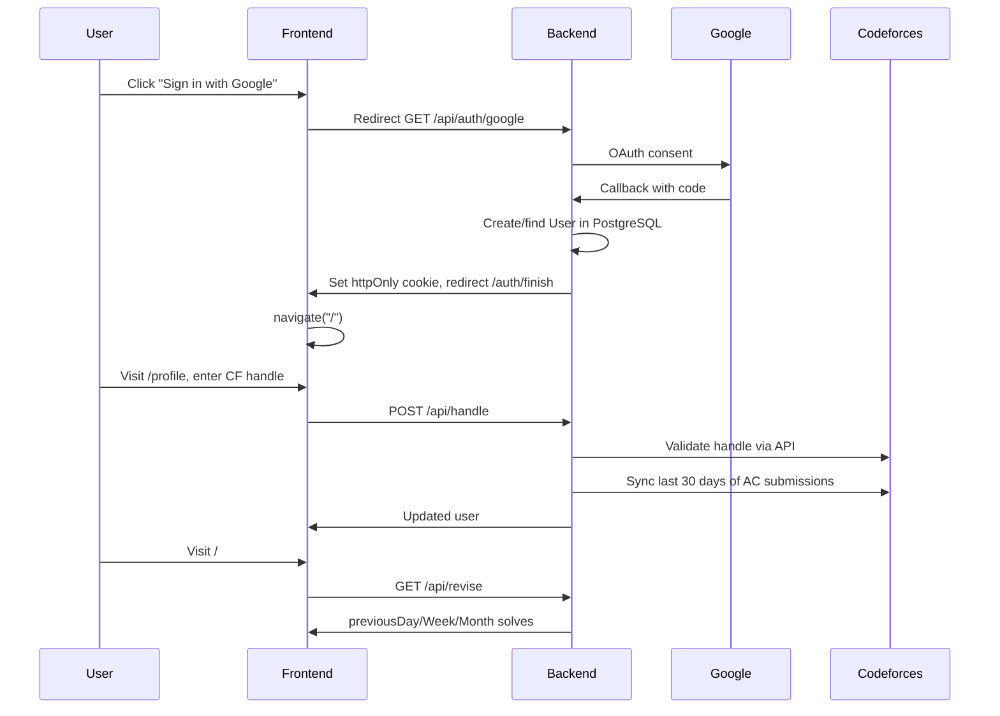

# Frontend Directory Analysis — PracticeCF

## Project Overview

PracticeCF is a Codeforces revision tracker aimed at competitive programmers who want to retain problem-solving patterns through spaced repetition. The frontend is a React 19 + TypeScript SPA built with Vite. It communicates with an Express backend via cookie-based JWT auth and exposes two primary user-facing surfaces: a **revision dashboard** (problems solved 1 / 7 / 30 days ago) and a **profile page** (handle, rating, 30-day solve histogram).

The app’s core loop:

1. User signs in with Google OAuth (backend creates or finds a user record).
2. User links a Codeforces handle on the profile page (backend validates handle, stores rating, triggers initial 30-day solve sync).
3. Backend syncs solves daily via cron; frontend reads stored solve data for revision buckets and stats.

---

## Directory Structure

```
frontend/
├── index.html                 # Entry HTML, Inter font, SPA mount point
├── package.json               # Dependencies: React 19, Vite 7, axios, recharts, Tailwind 4
├── vite.config.ts             # Vite + React + Tailwind plugins
├── tsconfig.json              # Project references (app + node configs)
├── eslint.config.js           # ESLint 9 flat config
├── public/
│   └── _redirects             # Netlify SPA fallback (/* → /index.html)
├── dist/                      # Production build output (committed or generated)
└── src/
    ├── main.tsx               # App bootstrap: BrowserRouter, Navbar, AppRouter
    ├── index.css              # Tailwind import (default Vite styles commented out)
    ├── axios.ts               # Axios instance (baseURL, withCredentials)
    ├── vite-env.d.ts          # Vite env type declarations
    ├── routes/
    │   └── AppRouter.tsx      # Route definitions (3 routes)
    ├── pages/
    │   ├── newdash.tsx        # Dashboard — revision problem list
    │   ├── Profile.tsx        # Profile — handle, rating, histogram
    │   ├── AuthFinish.tsx     # OAuth redirect landing → navigates to /
    │   └── login.tsx          # Unused standalone login page (hardcoded localhost URL)
    ├── components/
    │   ├── Navbar.tsx         # Global nav: logo, Home, Profile, auth buttons
    │   └── dashcomp.tsx       # FilterButton + QuestionsTable for dashboard
    ├── services/
    │   └── api.ts             # getRevisionSolves() typed API wrapper
    ├── styles/
    │   ├── dashboard.css      # Dashboard layout and card styles
    │   └── navbar.css         # Navbar layout
    └── profile.css            # Profile page layout, cards, graph, form controls
```

**Notable absences:** no `App.tsx`, no shared layout component, no global state layer, no tests, no hooks folder, no types folder, no error boundary, no loading skeleton components, and no environment example file (`.env.example`).

---

## Tech Stack

| Layer | Choice | Notes |
|-------|--------|-------|
| Framework | React 19 | Functional components, hooks only |
| Build | Vite 7 | Fast dev, ESM-native |
| Language | TypeScript 5.9 | Strict project refs via `tsconfig.app.json` |
| Routing | React Router 7 | BrowserRouter, 3 routes |
| HTTP | Axios | Single instance with `withCredentials: true` |
| Charts | Recharts 3 | Bar chart on profile page |
| Styling | Tailwind 4 + plain CSS | Tailwind imported but largely unused; pages use hand-written CSS files |
| Auth | Cookie JWT (httpOnly) | No frontend token storage; relies on backend cookies |

---

## Application Bootstrap & Routing

```text
main.tsx
  └── BrowserRouter
        ├── Navbar (always visible, auth check on mount)
        └── AppRouter
              ├── /              → Dashboard (newdash.tsx)
              ├── /profile       → ProfilePage
              └── /auth/finish   → AuthFinish (post-OAuth redirect)
```

`login.tsx` exists but is **not wired into the router**. Login is handled exclusively through the Navbar’s “Sign in with Google” button, which redirects to `{VITE_BASE_URL}/api/auth/google`.

---

## Page Layout

### Global Shell

Every page shares a fixed top **Navbar** (64px, white, max-width 1120px) with:

- **PracticeCF** logo (plain text, not a link)
- **Home** link → `/`
- **Profile** link → `/profile` (only when logged in)
- **Sign in with Google** or **Logout** button

There is no footer, sidebar, or responsive mobile menu.

### Dashboard (`/` — `newdash.tsx`)

```text
┌─────────────────────────────────────────────────────────┐
│ Navbar                                                  │
├─────────────────────────────────────────────────────────┤
│  gray background (#f3f4f6), max-width 1120px centered   │
│                                                         │
│  ┌──────────────────────────────────────┐               │
│  │ [Yesterday] [7 Days Ago] [30 Days Ago]│  filter tabs │
│  └──────────────────────────────────────┘               │
│                                                         │
│  ┌──────────────────────────────────────┐               │
│  │  {Selected Period Title}             │  white card   │
│  │  ─────────────────────────────       │               │
│  │  • Problem Name (link to CF)         │               │
│  │  • Problem Name                      │               │
│  │  ...                                 │               │
│  └──────────────────────────────────────┘               │
└─────────────────────────────────────────────────────────┘
```

**Behavior:**

- On mount, calls `GET /api/revise` via `getRevisionSolves()`.
- Maps backend fields: `previousDay` → yesterday, `previousWeek` → sevenDaysAgo, `previousMonth` → thirtyDaysAgo.
- Shows loading text, error message (with hint to set handle), or empty state.
- Filter tabs switch local state; no URL query params or persistence.

### Profile (`/profile` — `Profile.tsx`)

```text
┌─────────────────────────────────────────────────────────┐
│ Navbar                                                  │
├─────────────────────────────────────────────────────────┤
│  gray background, max-width 1120px, vertical stack      │
│                                                         │
│  ┌──────────────────────────────────────┐               │
│  │  @handle (CF-colored, linked)  [Refresh]            │
│  │  Rank title (colored)                               │
│  │  Rating: XXXX    Email: user@gmail.com              │
│  └──────────────────────────────────────┘  profile card  │
│                                                         │
│  ┌──────────────────────────────────────┐               │
│  │  Problems Solved (Last 30 Days)      │               │
│  │  ▁▃▅▇█▃▁ ... (Recharts bar chart)    │               │
│  └──────────────────────────────────────┘  graph card   │
└─────────────────────────────────────────────────────────┘
```

**Behavior:**

- `GET /api/auth/me` — fetch current user (handle, rating, email).
- If no handle: show input + Submit → `POST /api/handle` (one-time, immutable on backend).
- If handle exists: `GET /api/stats/histogram` for 30-day bar chart; Refresh button calls `GET /api/refresh/user`.
- CF rank colors and LGM first-letter styling mirror Codeforces conventions.

### Auth Finish (`/auth/finish`)

Minimal page: displays “Signing you in…” and immediately `navigate("/")`. Backend sets httpOnly cookie during OAuth callback before redirecting here.

---

## API Integration

### Axios Configuration (`axios.ts`)

```typescript
baseURL: import.meta.env.VITE_BASE_URL
withCredentials: true
```

All authenticated requests rely on the backend setting an httpOnly `token` cookie during Google OAuth callback.

### Endpoints Used by Frontend

| Method | Path | Used In | Purpose |
|--------|------|---------|---------|
| GET | `/api/auth/google` | Navbar | Redirect to Google OAuth |
| GET | `/api/auth/me` | Navbar, Profile | Check auth / fetch user |
| GET | `/api/auth/logout` | Navbar | Clear cookie, logout |
| GET | `/api/revise` | Dashboard | Revision buckets (1/7/30 day) |
| POST | `/api/handle` | Profile | Link CF handle (once) |
| GET | `/api/stats/histogram` | Profile | 30-day solve counts |
| GET | `/api/refresh/user` | Profile | Refresh CF rating |

### Data Types (`services/api.ts`)

```typescript
Solve {
  contestId: number
  index: string
  problemName: string
  link: string
  solvedAt: string
}

ReviseResponse {
  previousDay: Solve[]
  previousWeek: Solve[]
  previousMonth: Solve[]
}
```

Profile page defines its own inline `User` and `HistogramResponse` types instead of sharing a central types module.

---

## Component Breakdown

| Component | Location | Responsibility |
|-----------|----------|----------------|
| `Navbar` | `components/Navbar.tsx` | Auth state, login/logout, nav links |
| `FilterButton` | `components/dashcomp.tsx` | Tab-style filter for time buckets |
| `QuestionsTable` | `components/dashcomp.tsx` | Renders solve list as linked list items |
| `Dashboard` | `pages/newdash.tsx` | Fetches revision data, manages filter state |
| `ProfilePage` | `pages/Profile.tsx` | User info, handle setup, histogram, refresh |
| `AuthFinish` | `pages/AuthFinish.tsx` | Post-OAuth redirect handler |

---

## Styling Approach

The project uses a **hybrid styling model** that is partially inconsistent:

1. **Tailwind 4** is installed and imported in `index.css`, but almost no Tailwind utility classes appear in components.
2. **Page-scoped CSS files** (`dashboard.css`, `profile.css`, `navbar.css`) define the actual visual design.
3. **Design tokens** exist only in `profile.css` (`:root` CSS variables); dashboard and navbar use hardcoded hex values.
4. **Inter font** is loaded in `index.html` but not applied globally (profile uses `system-ui`; dashboard inherits browser default).

Visual language: light gray page background, white cards with soft shadows, black active filter tab, minimal color beyond CF rank colors on profile.

---

## Auth Flow (End-to-End)



---

## Current Issues & Technical Debt

### Architecture

- **Duplicate auth checks:** Navbar and Profile each independently call `/api/auth/me`; no shared auth context.
- **Dead code:** `login.tsx` is unused; `App.tsx` import is commented out in `main.tsx`.
- **Inconsistent API paths:** Navbar auth check uses `"api/auth/me"` (no leading slash) while other calls use `"/api/auth/me"`.
- **No protected routes:** Unauthenticated users can visit `/` and `/profile`; pages show errors inline rather than redirecting to login.
- **No error handling layer:** API errors are caught per-page with generic messages; no toast/notification system.

### UX

- Dashboard shows a generic error when not logged in or handle is missing; no guided onboarding flow.
- Solved-at timestamps are fetched but commented out in `QuestionsTable`.
- No loading skeletons — only plain text “Loading…”.
- No mobile navigation (hamburger menu); navbar links may overflow on small screens.
- Profile page shows raw “Not authenticated” with no login CTA.

### Styling

- Tailwind is a dependency but unused — adds bundle/config overhead without benefit.
- Three separate CSS files with overlapping patterns (cards, buttons, shadows).
- Global `index.css` body styles are commented out; layout consistency depends on per-page CSS.

### Types & Code Quality

- Types split between `api.ts` and inline definitions in `Profile.tsx`.
- `getRevisionSolves()` has a redundant try/catch that re-throws.
- File naming is inconsistent: `newdash.tsx`, `dashcomp.tsx` vs `Profile.tsx`, `Navbar.tsx`.
- No tests, no Storybook, no CI lint/typecheck gate visible in frontend.

### Environment & Deployment

- `.env` exists locally (not committed) with `VITE_BASE_URL`; no `.env.example` for contributors.
- `public/_redirects` suggests Netlify deployment; backend CORS expects `FRONTEND_URL`.
- `dist/` appears present in the repo — built artifacts may be checked in unintentionally.

---

## Backend Context (Relevant to Frontend)

Understanding backend behavior clarifies frontend expectations:

| Backend Feature | Detail |
|-----------------|--------|
| User creation | On first Google OAuth login via `oauth.services.ts` |
| Handle linking | One-time, validated against CF API; triggers 30-day backfill sync |
| Daily sync | Cron job syncs last 24h solves for all users |
| Revision logic | Queries solves on exact calendar days (yesterday, 7 days ago, 30 days ago) in IST |
| Data model | `User` (id, email, handle, rating) + `Solve` (contestId, index, problemName, link, solvedAt) |

The frontend currently surfaces only a subset of what the backend could expose (no difficulty, tags, notes, streaks, or revision completion tracking).

---

## Summary

PracticeCF’s frontend is a small, readable SPA with a clear two-page layout (dashboard + profile) and a global navbar. It successfully demonstrates the core revision workflow but is at an **MVP/prototype stage**: minimal routing, no shared state, mixed styling strategy, no onboarding, and no production hardening (error boundaries, tests, env docs, responsive polish). The codebase is a solid foundation for a Codeforces grinding platform, with the main growth vectors being richer analytics, guided practice flows, and a cohesive design system.
